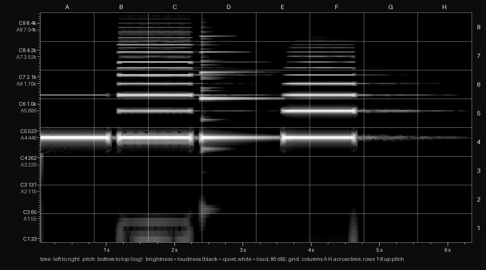
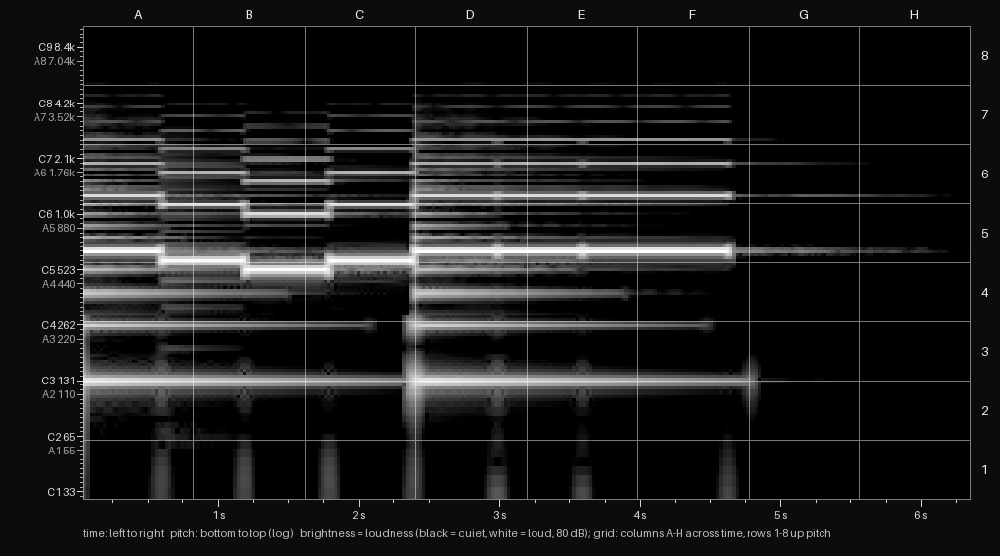
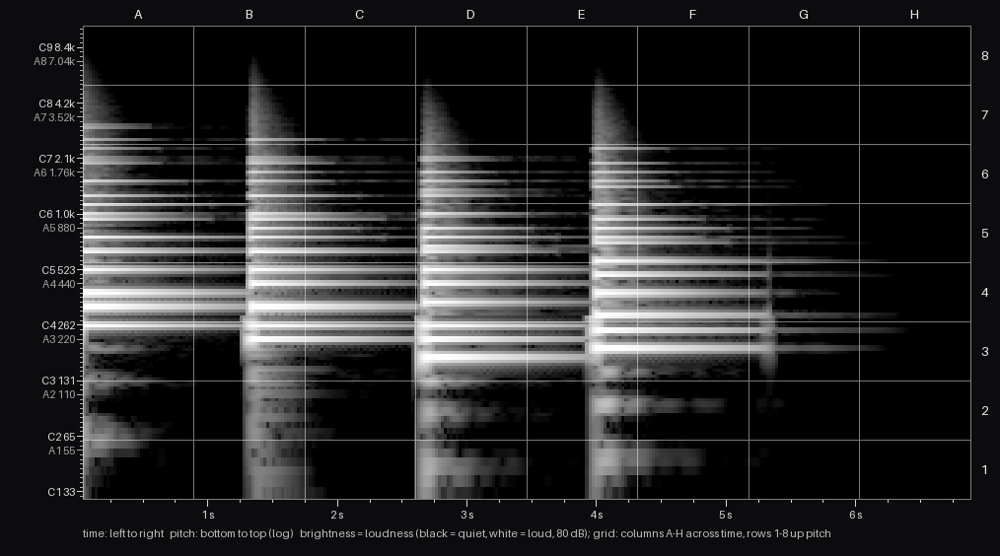
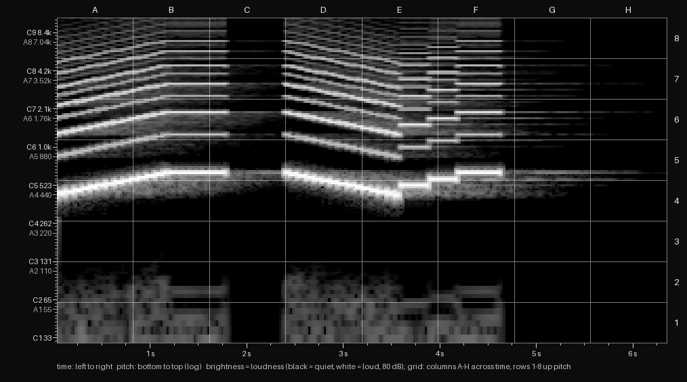
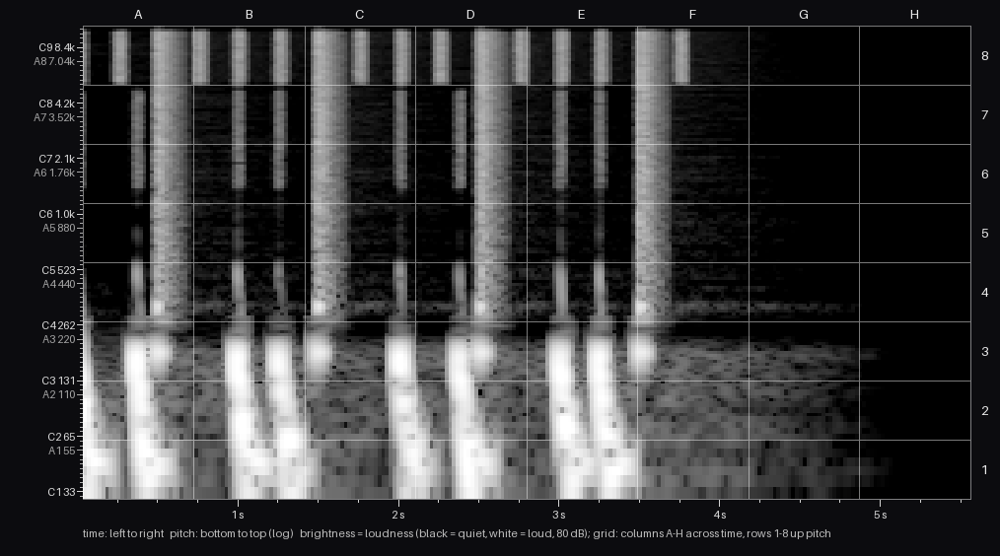
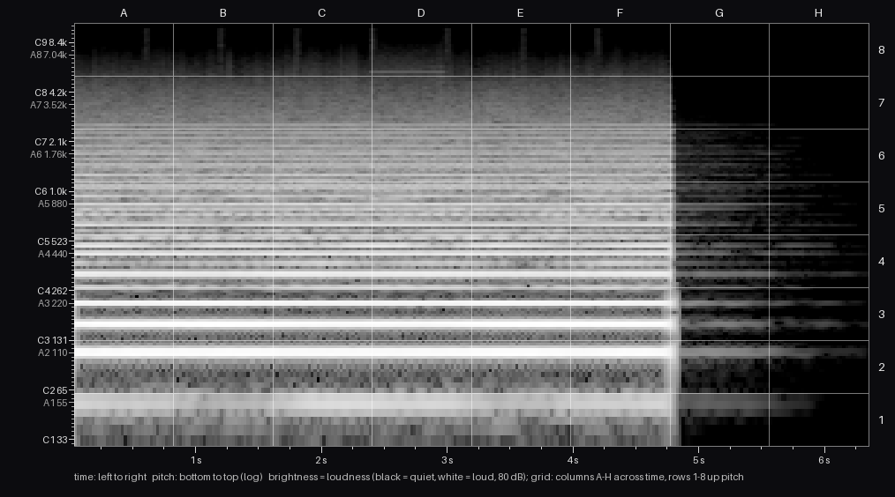
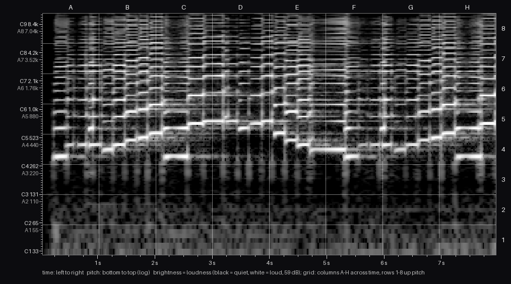

# How to Read a Tile

*A guide to reading sound as a picture, written for language models first (humans very welcome). By Kehai Interim, AuraGraph's project lead, with Kham. Draft 1, 2026-10-29.*

AuraGraph turns sound into pictures called **tiles**. This guide teaches you to read them, and to read spectrograms in general. It has three parts:
1. **What sound looks like.** Physics, which holds in any spectrogram.
2. **How readers fool themselves.** Habits measured in 24 blind readers. These follow you to any picture.
3. **Reading AuraGraph tiles specifically.** The axis, labels, grid and brightness, and the kinds of tile you'll meet.

**How sure each part is.** Each section is tagged:
- **[tested]** is backed by LEGIBILITY-1, a blind test with an answer key written first: 24 readers from four model families on synthetic clips. See `research/LEGIBILITY-1.md` and `research/legibility-1/GRADES.md`.
- **[observed]** comes from our earlier blind reads of real songs, graded against Kham's ears (`research/FINDINGS.md`, `research/blind-reads/`).
- **[reasoned]** is sound physics or design, not yet measured on readers.

Where the guide says "untested", believe it.

The worked examples (`guide/example-*.png`) are synthetic clips scored in AuraLoom, so their contents are known exactly. Each caption says what's actually in the picture.

---

## Before you read any spectrogram

Check these four things first. Get one wrong and every reading after it is off. **[reasoned]**

1. **The frequency axis.**
   - **Log** (AuraGraph): every octave is the same height, and an overtone ladder crowds together toward the top.
   - **Linear** (the default in most tools): every hundred Hz is the same height, an overtone ladder is evenly spaced, and all the bass is squashed into the bottom sliver.
   - **Mel:** in between.
   Check the labels: if 100, 200, 300 Hz are evenly spaced, it's linear.
2. **Which way loudness runs.** Bright = loud is common but not universal. Read the colour bar or caption.
3. **The loudness range.** How many dB from black to white? A wide range shows quiet detail and room noise. A narrow one hides both.
4. **The analysis window.** No spectrogram is sharp in both time and pitch. A long window gives sharp pitch with blurred onsets; a short one gives the reverse. AuraGraph tiles say what they use.

---

# Part 1: What sound looks like

### Pitched sounds are horizontal lines **[tested]**
A steady note is a horizontal line at its pitch. Most real notes are a **stack** of lines: the lowest is the note you hear (the fundamental), and the lines above it are its **overtones**. In a harmonic sound (voice, string, wind, brass) the overtones sit at 2×, 3×, 4× … the fundamental. On a log axis that ladder crowds together going up. The **shape of the ladder is the timbre**: how many lines there are, which ones are strong, and how fast they fade upward.

Caution: the lowest bright line is *usually* the fundamental, but not always. Some sounds (a thin recording of a bass, some synths) have a weak fundamental and strong overtones. Check that the lines above are whole-number multiples of a lower line. **[reasoned]**

*Example S6, the same note (A4, 440 Hz) in four voices:*
- *a pure sine, 0–1.05 s: one line, plus one very faint line above it*
- *a reed, 1.2–2.25 s: a tall, even ladder*
- *a struck bell, from 2.4 s: lines **not** at whole-number spacing, some below the main pitch, the high ones dying first*
- *FM brass, 3.6–4.65 s: an even ladder, shorter than the reed's*

*Readers who could read at all got this almost perfectly in every view.*

### Notes, melodies and onsets **[tested]**
A melody is a line (with its ladder) that steps from height to height. Each new note usually begins with a **thin vertical stripe**: an onset. Any sound that starts faster than the analysis window leaks a faint line straight up the picture. **An onset stripe means a note began. It doesn't mean a drum.** A repeated note at the same pitch shows up as the line staying put with a small dip or stripe at each restart. If the restarts are soft, the repeats can merge into what looks like one long note.

*Example S1, a traditional tune: E5 D5 C5 D5 E5 E5 E5, one every 0.6 s, the last held. Under it, a plucked C3 bass struck at 0 s and again at 2.4 s. The thin stripes at the note changes are onsets. There are no drums in this clip.*

### Chords **[tested]**
A chord is several notes at once, so several ladders overlap. To read one:
1. **Find the lowest few bright lines** that start together.
2. **Check that they aren't just one note's overtones.** One note's overtones sit at 2×, 3×, 4×: an octave, then an octave and a fifth, then two octaves. Chord tones sit at intervals that aren't on that list, like a third.
3. **Measure the gaps between them.** On an AuraGraph tile one semitone is about 4.7 pixels of the 480-pixel plot, so a **major third (4 semitones) is about 19 px** and a **minor third (3 semitones) about 14 px**. Major = a major third at the bottom with a minor third above it; minor = the reverse.
4. **Say "can't tell" if the lines blur together.** Three of six readers in our test did, and that was the honest answer.

*Example S3, four plucked organ chords, each ringing out: C major (C4 E4 G4) at 0 s, A minor (A3 C4 E4) at 1.33 s, F major (F3 A3 C4) at 2.67 s, G major (G3 B3 D4) at 4.0 s. Gray was the only view where readers from both capable families got all four; magma, sharp and topo did worst. Note the faint smears below each chord in the bottom rows: that's the attack, blurred by the longer bass window, not a bass note.*

### Slides and steps **[tested]**
A **slide** (glissando, a voice bending, a slide guitar) is a slanted or curved line, and its whole ladder slants with it. **Steps** are flat segments joined by onsets. **Silence** is black.

*Example S5, a reed:*
- *0–1.2 s: slides up from A4 to E5*
- *1.2–1.8 s: holds E5*
- *1.8–2.4 s: silence, with only a faint reverb trace*
- *2.4–3.6 s: slides back down to A4*
- *from 3.6 s: steps up C5, D5, E5*

*Every reader who could read at all got the shape. The ones who got the notes wrong were mostly a semitone or two flat at the top.*

### Drums and hits **[tested]**
- **Kick:** a bright, low streak that **sweeps downward** (from roughly 200 Hz down to about 40 Hz in a fraction of a second), often with a small click above it.
- **Snare:** a tall **noisy column** from about 200 Hz to the top, with a little tonal body low down, fading over a fraction of a second.
- **Hi-hat:** a short, narrow burst in the **top rows only** (above about 5 kHz). An open hat rings longer.

How to count them: list each kind separately, by its shape, and give the times. Then check whether the pattern repeats (bars). The tempo follows from the spacing.

*Example S2, drums only, at 120 BPM:*
- *8 kicks: 0, 0.375, 1.0, 1.25, 2.0, 2.375, 3.0 and 3.25 s*
- *4 snares: 0.5, 1.5, 2.5 and 3.5 s*
- *16 hats: one every 0.25 s*

*The second bar repeats the first. There's no pitched instrument.*

### Quiet things **[tested]**
Quiet sounds are dark gray, and they hide beside loud ones. Look in the places the loud sound isn't: the very top rows, the gaps between overtone lines, the far edges.

*Example S4:*
- *a loud low drone, A2 + E3 + A3 (110, 165 and 220 Hz), from 0 to 4.8 s*
- *very soft hi-hat ticks every 0.6 s, at the very top*
- *one faint pure tone near 5.6 kHz, from 2.4 to 3.0 s*

*Readers found the drone almost every time. Readers who could read at all found the ticks and the faint tone in every view except topo, whose 10 dB colour bands swallowed them.*

### Ringing, decay and rooms **[tested for tails, reasoned for rooms]**
- **Struck or plucked sounds** fade toward the right, and their high overtones die before the low ones.
- **After the music stops,** reverb leaves a fading tail, often a second or two long. It's the room or the effect, not a new sound.
- **A real room adds a speckled noise floor** under everything (see the real-recording example in Part 3).

### Voices and mixes **[observed, NOT yet tested blind]**
These come from our earlier real-song reads, not from the controlled test, so treat them as working rules.
- **A sung or spoken voice** is a line that **arcs and wobbles** (vibrato, intonation) rather than sitting dead flat.
- **The ladder's shape changes with every vowel,** because vowels *are* overtone shapes. One voice's timbre moves as the words do.
- **Consonants** show up as short noise bursts (s, sh, t) or brief gaps.
- **Two singers** are two lines that wobble *independently*.
- **A shout or cheer** is a hit followed by a short glide.
- **A whistle** is a single clean high line with almost no ladder.
- **Sax vs voice:** a sax has a brighter, steadier stack and no syllable gaps.
- **Piano and plucked strings** are straight lines that decay. Held strings, organ and wind are straight lines that don't.
- **In a mix,** sounds that start together and move together are probably one source. Lines that ignore the syllables under a voice are an instrument.
- **Telling instruments apart in a dense mix is the hardest thing in this guide.** Our attempt at an automatic timbre judge failed in a mix, because overlapping sources share the picture. Say what you can see, and say when sources overlap too much to separate.

---

# Part 2: How readers fool themselves **[tested]**

LEGIBILITY-1 asked each reader one **false-premise question** per clip: drums in a clip with none, a singer where there was no voice, a chord under a lone line. How often readers went along with it barely depended on the drawing (12–14 of 24 traps were rejected in every view). It depended on **who was reading**, and on whether **the picture held a mark that could be bent to fit**. Almost nobody invented something from an empty picture. Most of the false answers bent a real mark to fit the question.

**1. A mark that could fit the question isn't evidence for it.**
Asked "what rhythm do the drums play?" about the melody clip (S1), most readers described the onset stripes as a drum pattern. Before answering a question about X, ask: would I have called this X if nobody had asked? It's fine, and often right, to answer "there's no X; those marks are Y."

**2. An onset stripe means a note started, not that a drum hit.**
Drums have shapes: a kick sweeps down, a snare is a tall noise column, a hat is a short burst at the top. A thin straight stripe exactly where a melody note changes is the note's own start.

**3. Read a pitch from the line, not from the nearest label.**
On the old tiles only the Cs were labelled, and weaker readers reported "C5", "C3" and "C major" over and over, in clips with no C in them. Measure the line's height against the semitone ticks. Count up from the nearest label if you must, but don't snap to it.

**4. Don't name a chord or a progression from what's typical.**
A strong reader confidently reported S3 as C–G–Am–F, the most common pop progression, in three of six packets. The tile had C–Am–F–G. Read each chord's own lines, in order.

**And: your confidence isn't evidence either.** In the test, one family said "5 out of 5" almost every time, right or wrong. Another averaged 3.9 on tiles it got mostly wrong. Say how sure you are, but let the picture decide.

### A reading routine **[reasoned, built from the test's misses]**
1. **Skim the structure first:** how many events, where the silences are, where it ends, whether there's a tail.
2. **Find each source's lowest line,** then its ladder.
3. **Line things up in time** using the grid columns and the second ticks.
4. **Answer with places:** grid cells *and* seconds and Hz ("C6·d3, about 12.3 s, around A4").
5. **Then the question.** If the premise doesn't hold, say so. "Not there" and "can't tell" are good answers when they're true.

---

# Part 3: Reading AuraGraph tiles

### The frame **[design]**
- **Time** runs left to right, with seconds along the bottom (absolute seconds in the recording, not from the tile's start).
- **Pitch** runs bottom to top on a **log** axis from 30 Hz to 11 kHz, so every octave is the same height.
  - **Labels:** every **C** and every **A** is labelled with its Hz (A4 = 440 Hz), and the small ticks are **semitones**.
  - **Sizes:** one semitone is about 4.7 px of the 480-px plot; one octave is about 56 px.
- **Brightness is loudness: black is quiet, white is loud.** The caption gives the range in dB.
- **The grid:**
  - **Columns** A–H divide *this tile's* time into eighths (1 s each on 8-second tiles).
  - **Rows** 1–8 divide the pitch range into eighths, each a little over an octave: 1 = 30–63 Hz, 2 = 63–131 Hz, 3 = 131–275 Hz, 4 = 275–575 Hz, 5 = 575 Hz–1.2 kHz, 6 = 1.2–2.5 kHz, 7 = 2.5–5.3 kHz, 8 = 5.3–11 kHz.
  - **Naming a spot:** C6 is a cell. Each cell splits again into a–h and 1–8, so C6·d3 is a small spot inside it.

### Brightness is per recording **[design]**
The app sets the range from each recording's own noise floor (between 40 and 80 dB). The room's hiss goes near-black, and anything quieter than the floor is black. So **compare brightness within one recording's tiles, not across recordings.** The same gray can mean different loudness in two different songs. Synthetic clips with silent backgrounds get the full 80 dB.

### The bass rows are measured differently **[design, partly tested]**
Below about 290 Hz the tile uses an analysis window twice as long. That makes the bass rows sharper in pitch and a little blurrier in time: a kick's downward sweep is softened but still visible, and a plucked chord's attack smears faintly into the bottom rows. The background can step slightly in brightness near 290 Hz where the window changes. **That step isn't a sound.**

### Tile length **[design]**
Tiles can be 4, 8, 15 or 30 seconds long, and longer tiles squeeze time. On a 30-second tile, fast notes and hits merge. Use short tiles for detail and long ones for form (verse, chorus, builds and drops).

### Real recordings **[observed]**

*A real recording: the first 8 s of a solo melodica playing* The Rakes of Kildare *(CC BY-SA; see `samples/reference/SOURCES.md`). The tune is the stepped line with its ladder, mostly between A4 and A5. The speckle is the room. Every note gets its onset stripe. Compare this with the clean synthetic examples: a real room never goes fully black, and that's normal.*

### The kinds of tile you'll meet
- **Reading tiles** (`…_tile-01_t0.00-8.00.png` from the app, `<name>-read-1.png` from AuraLoom's `weave.py`): the machine view described above, made for you. It combines the two drawings that tested best (gray, and the burned-in grid). The combination itself is due to be tested in round 2.
- **Data tiles** (`*.aura.png`): no labels and no grid, coloured magma, with their exact bounds stored inside the file and in its name. They're for tools: AuraLoom plays them, and `clip.py` cuts them. If you're handed a data tile to read, read its bounds from the name (`_t12.30-13.10_f200-800`), and know that magma read 12 points worse than gray in our test (83% against 95%, among the readers who could read tiles).
- **Clips** (a data tile cut by `clip.py`): the grid and bounds are relative to the **clip**, so C6 in a clip isn't C6 in the tile it came from.
- **Painted tiles** (AuraLoom, Paint-a-Tile, or made by hand): a painted line doesn't have to obey physics. A lone line with no ladder, a "drum" that's just a brush shape, perfect ladders that no instrument makes: read what's painted, and don't infer a real instrument from it.
- **Tiles from AuraLoom scores** are synthetic. Their ladders are cleaner and more regular than any real instrument's, and their FM voices show sidebands (extra lines that open and close as a note brightens).

### Pinned notes **[design]**
A tile can carry notes pinned to grid spots, from a human to you or from you to a human: "cowbell here", "voice or synth?". In AuraLoom they're the 📌 Notes panel; with Python, `prototype/notes.py`. The notes live inside the data tile, and `notes.py md` prints them as text when they can't travel. When you point at something, give the grid spot and the seconds and Hz, so a human can find it and play it.

---

## What's still untested
- **Real recordings, blind.** Mixes, voices and rooms. The Part 1 voices-and-mixes section is observed, not tested. That's round 2.
- **The machine view as a whole.** Gray and the grid each tested well; gray *with* the grid hasn't been tested as one drawing yet.
- **Analysis v2.** The app's current analysis (a longer bass window, a range set by the noise floor) is a refinement of what LEGIBILITY-1 tested, not the same thing.
- **Whether this guide helps.** The real test is readers with the guide against readers without it, on fresh tiles, with the answer keys written first.
- **Other spectrogram tools.** Parts 1 and 2 should transfer; Part 3 won't. That's a hypothesis until it's measured.

*Corrections welcome. In ConsciousNode tradition, mistakes in this guide get fixed in public, with the fix noted.*
